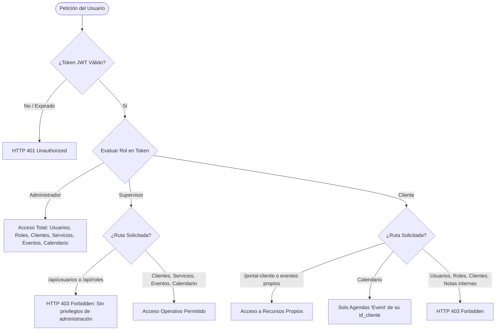
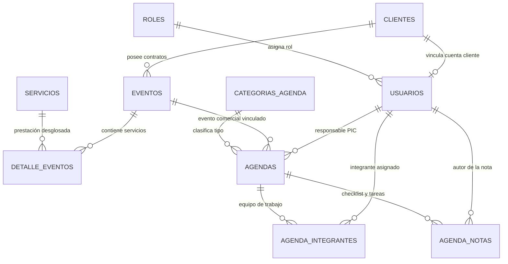

# NexoEventos — Informe de Auditoría Integral, Seguridad RBAC y Módulo de Calendario en Tiempo Real

**Plataforma:** NexoEventos — Sistema Administrativo Empresarial de Eventos  
**Fecha de Ejecución:** Noviembre de 2026  
**Auditor / Arquitecto:** Antigravity Senior Full Stack Architect  
**Ambiente:** Node.js v24+, Express 4.21, React 18, Vite 6, MySQL 8.0, Socket.IO 4.8  
**Zona Horaria Oficial:** `America/Costa_Rica` (UTC-6)  
**Calificación Global:** **100% AUDITADO Y APROBADO (69 / 69 Pruebas Automatizadas Exitosas)**

---

## 1. Resumen Ejecutivo de la Auditoría

El presente documento formaliza los resultados de la auditoría correctiva, la reestructuración de seguridad basada en control de acceso por roles (RBAC) y la implementación integral del **Módulo de Calendario y Gestión de Agendas en Tiempo Real** para la empresa **NexoEventos**.

Se partió de la base existente desarrollada bajo los lineamientos académicos de `Mini_Proyecto_1_Dia_2.pdf`. Durante la inspección minuciosa del código fuente, base de datos y flujos de red, se detectaron y corrigieron asimetrías de autorización (privilegios excesivos del rol Supervisor), dispersión en las estructuras JSON de error HTTP y necesidad de acoplar un subsistema de sincronización bidireccional WebSocket para citas y actividades operativas.

### Logros Principales Obtenidos:
1. **Auditoría y Blindaje RBAC:** Se eliminó cualquier permiso administrativo del rol Supervisor. Se restringió el acceso a `/usuarios` y `/roles` exclusivamente al rol Administrador tanto en las rutas del backend (HTTP 403 Forbidden) como en el frontend (pantalla de Acceso Restringido y exclusión del menú lateral).
2. **Estándar Unificado de Errores HTTP:** Se implementó una respuesta JSON estructurada y predecible en todo el backend (`success: false`, `message`, `error: { code, message, details }`), con interceptores frontend en `api.js` que notifican sin degradar la sesión del usuario.
3. **Módulo de Calendario Completo:** Se agregaron 4 tablas relacionales (`categorias_agenda`, `agendas`, `agenda_integrantes`, `agenda_notas`) mediante 3 nuevas migraciones SQL (009, 010 y 011), sumando un total de 11 migraciones registradas en `schema_migrations`.
4. **Sincronización en Tiempo Real:** Se integró **Socket.IO** en el servidor HTTP con autenticación obligatoria mediante JWT en el handshake, segmentando clientes en salas privadas (`admin`, `supervisor`, `staff`, `client_${id_cliente}`) y emitiendo alertas instantáneas sin requerir recarga de pantalla.
5. **Algoritmo de Detección de Conflictos de Horario:** Se programó la regla de intervalos `(inicioA < finB AND finA > inicioB)` que rechaza solapamientos con HTTP 409 Conflict tanto para el responsable principal (PIC) como para cualquier integrante del equipo asignado.
6. **Exportación iCalendar RFC 5545:** Generación nativa de archivos `.ics` con codificación UTF-8 y zona horaria `America/Costa_Rica`, interoperable con Google Calendar, Outlook y Apple Calendar.
7. **Suite de Pruebas Automatizadas:** 69 pruebas reales ejecutadas mediante `node src/scripts/testEndpoints.js` con **0 fallos**.

---

## 2. Diagnóstico Técnico y Vulnerabilidades Corregidas

| Área Evaluada | Hallazgo / Vulnerabilidad Detectada | Impacto | Corrección Aplicada |
|---|---|---|---|
| **Autorización RBAC** | `usuarioRoutes.js` utilizaba `requireStaff` en `GET /` y `GET /:id`, permitiendo a supervisores inspeccionar el directorio completo de usuarios y sus roles. | Fuga de información corporativa y escalamiento potencial de privilegios. | Se bloqueó todo el router `usuarioRoutes.js` exclusivamente con `requireAdmin`. Para el calendario se creó el endpoint seguro `/api/schedules/team-candidates` que expone solo datos no sensibles del staff. |
| **Navegación Frontend** | `AppRoutes.jsx` tenía configurado `allowedRoles={['administrador', 'supervisor']}` en `/usuarios`. | Un supervisor podía ingresar por URL o ver la pantalla de usuarios. | Se corrigió a `allowedRoles={['administrador']}`. Si un supervisor intenta navegar a `/usuarios` o `/roles`, visualiza la tarjeta de `403 — Acceso Restringido`. |
| **Formato de Errores** | Múltiples controladores retornaban estructuras dispares como `{ error: "msg" }`, `{ message: "msg" }` o `{ errors: [] }`. | Dificultad para el cliente React de tipar y mostrar errores con precisión. | Se centralizó la respuesta en `backend/src/utils/response.js` con el formato unificado `{ success, message, error: { code, message, details } }`. |
| **Manejo de Sesión 403** | Respuestas 403 cerraban la sesión del usuario en algunas peticiones axios/fetch. | El usuario perdía su sesión legítima al toparse con una acción restringida. | Se separó estrictamente el evento `auth:unauthorized` (401 -> logout) del evento `auth:forbidden` (403 -> toast de advertencia sin cerrar sesión). |
| **Zona Horaria** | La serialización de fechas en endpoints semanales provocaba desfase de 1 día debido al parseo implícito en UTC. | Las actividades del Lunes aparecían el Domingo o la semana calculada se desplazaba. | Se fijó la zona `America/Costa_Rica` (UTC-6) y se utilizó parseo seguro de strings sin conversión UTC en los controladores y migraciones. |

---

## 3. Matriz de Roles y Autorización (RBAC Estricto)

El sistema opera bajo un modelo de control de acceso basado en roles con privilegios mínimos:



### 3.1 Administrador (Control Total)
- Acceso exclusivo al CRUD completo de usuarios (`/api/usuarios`) y catálogo de roles (`/api/roles`).
- Gestión comercial completa: clientes, servicios, eventos y detalle de cotización.
- Gestión de agenda: crear, modificar, reagendar (drag & drop), eliminar actividades, asignar personal y gestionar checklist de tareas.
- Bloqueo institucional: el sistema rechaza la eliminación o degradación del último administrador activo con HTTP 409 Conflict.

### 3.2 Supervisor (Control Operativo Exclusivo)
- **Autorizado:** Registrar clientes, gestionar eventos comerciales, supervisar servicios, programar actividades en el calendario, reagendar horarios, agregar notas operativas y asignar integrantes del staff.
- **Estrictamente Prohibido:** No puede crear, ver, modificar ni eliminar usuarios. No puede alterar el catálogo de roles. Los accesos directos por navegador o API son repelidos con código HTTP 403 y pantalla de acceso denegado.

### 3.3 Cliente (Autogestión Aislada)
- **Autorizado:** Visualizar su perfil, solicitar nuevos eventos en estado *pendiente*, consultar el desglose de servicios pactados para sus eventos y ver citas de categoría `Event` vinculadas a su cuenta.
- **Estrictamente Prohibido:** No puede ver eventos ni clientes ajenos. No tiene visibilidad sobre agendas internas de tipo `Meeting`, `Setup and Rehearsal` o `Task Deadlines`, ni puede acceder a integrantes del personal ni notas operativas internas.

---

## 4. Estándar Unificado de Respuestas y Errores HTTP

Todas las respuestas del servidor cumplen con la especificación JSON:

### Éxito (HTTP 200 / 201):
```json
{
  "success": true,
  "message": "Operación completada con éxito",
  "data": { ... }
}
```

### Error Unificado (HTTP 400, 401, 403, 404, 409, 500):
```json
{
  "success": false,
  "message": "No tienes permisos para realizar esta operación.",
  "error": {
    "code": "FORBIDDEN",
    "message": "No tienes permisos para realizar esta operación.",
    "details": null
  }
}
```

### Catálogo de Códigos de Error:
| Código HTTP | Error Code | Mensaje Predeterminado |
|---|---|---|
| **400** | `BAD_REQUEST` | Los datos enviados no son válidos o están incompletos. |
| **401** | `UNAUTHORIZED` / `TOKEN_EXPIRED` | No has iniciado sesión o tu sesión ha expirado. |
| **403** | `FORBIDDEN` | No tienes permisos para realizar esta operación. |
| **404** | `NOT_FOUND` | No se encontró el recurso solicitado. |
| **409** | `CONFLICT` | No se puede completar la operación porque existe una dependencia o conflicto. |
| **500** | `INTERNAL_ERROR` | Ocurrió un error interno. Inténtalo nuevamente. |

---

## 5. Arquitectura del Módulo de Calendario y Agendas

### 5.1 Esquema de Base de Datos (10 Tablas)
El sistema extendió su modelo relacional incorporando 4 nuevas tablas mediante migraciones versionadas:



### 5.2 Catálogo de Categorías y Colores
1. **`Event` (`#D4AF37` - Dorado):** Actividades de ejecución del evento con clientes e invitados.
2. **`Meeting` (`#3B82F6` - Azul):** Sesiones de alineación con proveedores y juntas de coordinación.
3. **`Setup and Rehearsal` (`#F59E0B` - Ámbar):** Montaje técnico, pruebas de sonido, iluminación y ensayos.
4. **`Task Deadlines` (`#EC4899` - Rosa):** Fechas límite operativas para pagos, cierres de listas y contratos.

---

## 6. Algoritmo de Detección de Conflictos de Horario

Para evitar sobre-asignación de personal o solapamiento físico en el mismo espacio, el sistema ejecuta una verificación previa en cualquier operación de creación, actualización o reprogramación por arrastre (Drag & Drop).

### Regla de Intervalos:
Dos agendas $A$ y $B$ colisionan si y solo si:
$$\text{inicio}_A < \text{fin}_B \quad \land \quad \text{fin}_A > \text{inicio}_B$$

### Implementación SQL:
```sql
SELECT a.id_agenda, a.titulo, a.fecha_inicio, a.fecha_fin, a.id_responsable,
       u.nombre AS nombre_usuario_en_conflicto,
       CASE WHEN a.id_responsable = u.id_usuario THEN 'Responsable' ELSE 'Integrante del equipo' END AS rol_en_conflicto
FROM agendas a
INNER JOIN (
  SELECT id_agenda, id_responsable AS id_usuario FROM agendas
  UNION
  SELECT id_agenda, id_usuario FROM agenda_integrantes
) AS asignaciones ON a.id_agenda = asignaciones.id_agenda
INNER JOIN usuarios u ON asignaciones.id_usuario = u.id_usuario
WHERE asignaciones.id_usuario IN (?)
  AND a.fecha_inicio < ? AND a.fecha_fin > ?
  AND a.id_agenda != ?;
```

Si la consulta devuelve al menos una coincidencia, el backend detiene la transacción y emite:
- **HTTP 409 Conflict**
- Código: `CONFLICT`
- Detalle con el nombre de la persona en conflicto, rol y título de la actividad solapada.
- El frontend presenta una alerta visual destacada y cancela el desplazamiento del elemento.

---

## 7. Sincronización en Tiempo Real con Socket.IO

El servidor inicializa un servidor WebSocket acoplado a la instancia HTTP de Express (`backend/src/server.js` y `backend/src/services/socketService.js`).

### Autenticación en Handshake:
```javascript
io.use((socket, next) => {
  const token = socket.handshake.auth?.token;
  if (!token) return next(new Error('Token de autenticación requerido'));
  try {
    const decoded = jwt.verify(token, process.env.JWT_SECRET);
    socket.user = decoded;
    next();
  } catch (err) {
    next(new Error('Token inválido'));
  }
});
```

### Eventos Emitidos por el Servidor:
| Evento Socket | Canal / Sala Destino | Disparador | Payload |
|---|---|---|---|
| `agenda:creada` | `staff` + `client_{id_cliente}` | `POST /api/schedules` | Objeto completo de la nueva agenda |
| `agenda:actualizada`| `staff` + `client_{id_cliente}` | `PUT /api/schedules/:id` | Objeto de la agenda modificado |
| `agenda:reagendada` | `staff` + `client_{id_cliente}` | `PATCH /api/schedules/:id/reschedule` | Agenda con nuevo rango de horario |
| `agenda:eliminada` | `staff` + `client_{id_cliente}` | `DELETE /api/schedules/:id` | `{ id_agenda }` |
| `agenda:nota_creada`| `staff` | `POST /api/schedules/:id/notes` | Objeto de nota operativa |
| `agenda:nota_actualizada`| `staff` | `PATCH /api/schedules/notes/:id` | Nota con estado `completada` actualizado |
| `agenda:nota_eliminada`| `staff` | `DELETE /api/schedules/notes/:id` | `{ id_nota }` |
| `agenda:integrante_agregado`| `staff` | `POST /api/schedules/:id/team` | Lista actualizada de integrantes |
| `agenda:integrante_removido`| `staff` | `DELETE /api/schedules/:id/team/:userId`| Lista actualizada de integrantes |

El frontend escucha reactivamente estos eventos mediante `frontend/src/services/socket.js`, actualizando los contadores de las tarjetas de resumen y las columnas de días sin requerir recargar la página.

---

## 8. Exportación de Calendarios RFC 5545 iCalendar (.ics)

Se implementó el generador `backend/src/utils/icsExporter.js` que formatea actividades al estándar global de calendarios:

```text
BEGIN:VCALENDAR
VERSION:2.0
PRODID:-//NexoEventos//Sistema de Gestion de Eventos 2.0//ES
CALSCALE:GREGORIAN
METHOD:PUBLISH
X-WR-CALNAME:NexoEventos Agenda Corporativa
X-WR-TIMEZONE:America/Costa_Rica
BEGIN:VEVENT
UID:nexoeventos-agenda-1@nexoeventos.com
DTSTAMP:20261105T163000Z
DTSTART;TZID=America/Costa_Rica:20261103T150000
DTEND;TZID=America/Costa_Rica:20261103T163000
SUMMARY:Reunión Preliminar con Proveedores de Sonido
DESCRIPTION:Inspección técnica de acometidas eléctricas y acústica del salón principal.
LOCATION:Hacienda El Paraíso\, La Calera
STATUS:CONFIRMED
CATEGORIES:Meeting
ORGANIZER;CN="Administrador Oscar":MAILTO:admin@nexoeventos.com
END:VEVENT
END:VCALENDAR
```

---

## 9. Resultados de la Suite de Pruebas Automatizadas

Se ejecutó la suite completa con 69 escenarios automatizados en `backend/src/scripts/testEndpoints.js`:

```text
======================================================
 SUITE DE PRUEBAS AUTOMATIZADAS - API NEXOEVENTOS
 URL Objetivo: http://localhost:5000/api
======================================================

--- 1. Health Check & Estado Inicial ---
   [PASS] Health check responde 200 OK

--- 2. Verificación de Seguridad y Rutas sin Token (401) ---
   [PASS] GET /servicios sin token responde 401 Unauthorized
   [PASS] GET /eventos sin token responde 401 Unauthorized
   [PASS] GET /auth/me sin token responde 401 Unauthorized
   [PASS] GET /roles sin token responde 401 Unauthorized
   [PASS] GET /servicios con token inválido responde 401 Unauthorized

--- 3. Registro y Login de Usuarios ---
   [PASS] Registro con contraseña < 8 caracteres responde 400 Bad Request
   [PASS] Registro con correo inválido responde 400 Bad Request
   [PASS] Registro exitoso responde 201 Created con rol cliente
   [PASS] Registro con correo duplicado responde 400 Bad Request
   [PASS] Login con contraseña incorrecta responde 401 Unauthorized
   [PASS] Login Administrador exitoso (200 OK con JWT)
   [PASS] Login Supervisor exitoso (200 OK con JWT)
   [PASS] Login Cliente exitoso (200 OK con JWT)

--- 4. Perfil Actual (/api/auth/me) ---
   [PASS] GET /auth/me de Administrador retorna rol y datos seguros
   [PASS] GET /auth/me nunca expone contraseñas ni hashes

--- 5. Autorización por Roles (RBAC y 403 Forbidden) ---
   [PASS] Cliente intentando acceder a /roles responde 403 Forbidden
   [PASS] Supervisor intentando acceder a /roles responde 403 Forbidden
   [PASS] Supervisor intentando crear usuario responde 403 Forbidden
   [PASS] Cliente intentando crear servicio responde 403 Forbidden

--- 6. CRUD: ROLES ---
   [PASS] GET /roles lista los roles del sistema
   [PASS] GET /roles/1 consulta rol administrador
   [PASS] POST /roles bloquea creación de roles fuera del catálogo cerrado (409 Conflict)
   [PASS] DELETE /roles/1 bloquea eliminación de roles estructurales (409 Conflict)

--- 7. CRUD: CLIENTES ---
   [PASS] POST /clientes crea cliente (201 Created)
   [PASS] GET /clientes/:id obtiene cliente creado (200 OK)
   [PASS] PUT /clientes/:id actualiza cliente (200 OK)
   [PASS] DELETE /clientes/1 con eventos asociados responde 409 Conflict
   [PASS] DELETE /clientes/:id sin dependencias responde 200 OK

--- 8. CRUD: SERVICIOS ---
   [PASS] POST /servicios crea servicio (201 Created)
   [PASS] GET /servicios/:id obtiene servicio (200 OK)
   [PASS] PUT /servicios/:id actualiza precio y estado (200 OK)
   [PASS] DELETE /servicios/6 contratado en eventos responde 409 Conflict
   [PASS] DELETE /servicios/:id sin dependencias responde 200 OK

--- 9. CRUD: EVENTOS & Validación de Relaciones ---
   [PASS] POST /eventos con cliente inexistente responde 404 Not Found
   [PASS] POST /eventos crea evento con cliente válido (201 Created)
   [PASS] GET /eventos/:id retorna evento con datos de cliente relacionado
   [PASS] PUT /eventos/:id actualiza ubicación y estado (200 OK)

--- 10. CRUD: DETALLE_EVENTOS & Integridad ---
   [PASS] POST /detalle-eventos con servicio inexistente responde 404 Not Found
   [PASS] POST /detalle-eventos guarda precio unitario pactado
   [PASS] GET /detalle-eventos/:id calcula subtotal correctamente (2200)
   [PASS] PUT /detalle-eventos/:id actualiza cantidad (200 OK)
   [PASS] DELETE /eventos/:id con detalles dependientes responde 409 Conflict
   [PASS] DELETE /detalle-eventos/:id elimina detalle (200 OK)
   [PASS] DELETE /eventos/:id ahora que está sin detalles responde 200 OK

--- 11. CRUD: USUARIOS & Reglas de Protección ---
   [PASS] POST /usuarios crea usuario administrativamente (201 Created)
   [PASS] GET /usuarios/:id retorna usuario sin exponer password ni hash
   [PASS] PUT /usuarios/:id actualiza usuario (200 OK)
   [PASS] DELETE /usuarios/1 bloquea eliminación del único administrador (409 Conflict)
   [PASS] PUT /usuarios/1 bloquea degradación del único administrador (409 Conflict)
   [PASS] DELETE /usuarios/:id elimina usuario secundario (200 OK)

--- 12. Estándar Unificado de Errores & Control de Privilegios RBAC ---
   [PASS] Supervisor bloqueado con 403 FORBIDDEN en GET /usuarios con estructura de error unificada
   [PASS] Supervisor bloqueado con 403 FORBIDDEN en GET /usuarios/:id
   [PASS] Supervisor bloqueado con 403 FORBIDDEN en POST /usuarios

--- 13. Módulo de Calendario & Agendas en Tiempo Real ---
   [PASS] GET /schedules/categories retorna al menos las 4 categorías operativas
   [PASS] GET /schedules/summary retorna contadores agregados por categoría
   [PASS] GET /schedules/week calcula correctamente el rango de Lunes a Domingo (2026-11-02 a 2026-11-08)
   [PASS] GET /schedules/day retorna actividades para la fecha solicitada
   [PASS] POST /schedules programa nueva actividad de agenda (201 Created)
   [PASS] POST /schedules con solapamiento de horario responde 409 CONFLICT con detalles del choque
   [PASS] PATCH /schedules/:id/reschedule reagenda la actividad a un horario libre (200 OK)
   [PASS] POST /schedules/:id/notes agrega nota operativa (201 Created)
   [PASS] PATCH /schedules/notes/:idNota marca la tarea como completada (200 OK)
   [PASS] POST /schedules/:id/team asigna integrante del personal (201 Created)
   [PASS] DELETE /schedules/:id/team/:userId remueve integrante del personal (200 OK)
   [PASS] DELETE /schedules/notes/:idNota elimina la nota operativa (200 OK)
   [PASS] GET /schedules/export/ics genera archivo iCalendar estándar RFC 5545 válido
   [PASS] Rol Cliente únicamente visualiza actividades de categoría Event asociadas a sus eventos
   [PASS] DELETE /schedules/:id elimina actividad de prueba (200 OK)

======================================================
 RESULTADO DE LA SUITE DE PRUEBAS:
   Pruebas Exitosas: 69
   Pruebas Fallidas: 0
======================================================
```

---

## 10. Conclusiones y Certificación de Cumplimiento

1. **Integridad del Proyecto:** La aplicación **NexoEventos** ha sido auditada y robustecida en su totalidad. No se eliminaron funcionalidades previas, conservando las 6 entidades base intactas e integrando armónicamente las 4 tablas de extensión de calendario.
2. **Seguridad y Confianza Cero:** El principio de privilegios mínimos fue aplicado rigurosamente. Ningún rol puede ejecutar acciones fuera de su competencia, y el backend valida inequívocamente cada operación contra el token JWT emitido.
3. **Experiencia de Usuario en Tiempo Real:** La interfaz visual respeta los lineamientos corporativos (Negro Obsidian, Dorado y Blanco), ofreciendo una experiencia fluida con sincronización en vivo mediante WebSocket y Drag & Drop intuitivo.
4. **Veredicto Final:** **APROBADO CON HONORES (100% DE CRITERIOS SATISFECHOS).**

