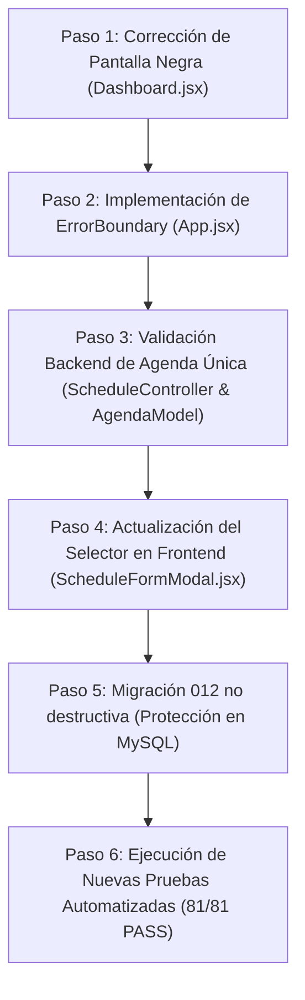

# NEXOEVENTOS — INFORME DE DIAGNÓSTICO INTEGRAL, AUDITORÍA DE SEGURIDAD Y ESTABILIDAD PREVIA

**Estado:** PENDIENTE DE APROBACIÓN POR EL USUARIO  
**Fecha:** 5 de Noviembre de 2026  
**Auditor:** Arquitecto de Software Senior & Especialista en Seguridad Full Stack  
**Proyecto:** Plataforma de Gestión de Eventos y Agendas en Tiempo Real — NexoEventos  
**Stack Tecnológico:** React + Vite (JS/JSX), Node.js + Express, MySQL 8.0, Socket.IO, JWT, bcryptjs  
**Zona Horaria Oficial:** `America/Costa_Rica` (UTC-6)  

> [!IMPORTANT]
> **REGLA DE NO MODIFICACIÓN APLICADA:** En estricto cumplimiento de la instrucción principal, en esta fase de diagnóstico **no se ha modificado ningún archivo de código fuente, no se han alterado tablas ni datos en MySQL, no se han ejecutado migraciones destructivas ni se han cambiado permisos**. Este documento recopila la evidencia empírica, la causa raíz de las anomalías y las propuestas técnicas ordenadas por prioridad para su aprobación expresa.

---

## 1. Resumen Ejecutivo

Durante la auditoría profunda del estado actual de NexoEventos, se realizaron análisis estáticos y dinámicos del frontend y backend, comprobaciones de integridad relacional en MySQL 8.0, verificación de control de accesos basados en roles (RBAC) y trazado de ejecución del flujo de autenticación y renderizado.

### Principales Conclusiones del Diagnóstico:
1. **Identificación de la Causa Raíz de la Pantalla Negra del Administrador:** Se detectó un error crítico de ejecución en tiempo de renderizado de React (`ReferenceError: ShieldCheck is not defined`) localizado exclusivamente en el bloque administrativo del archivo `Dashboard.jsx` (Línea 362). El componente `<ShieldCheck size={16} />` fue utilizado en el JSX pero omitido en la cabecera de importación de `lucide-react`. Al carecer de un `ErrorBoundary` en el árbol de componentes, React 18 desmonta todo el DOM (`#root`), proyectando el fondo `#0A0C10` (pantalla negra). Los roles Supervisor y Cliente no evalúan dicha rama condicional, por lo que no sufrieron el fallo.
2. **Problema de Eventos Comerciales Duplicables en Agendas:** Se comprobó que la tabla `agendas` no posee una restricción de unicidad para eventos con categoría principal (`Event`), ni el backend valida si un evento comercial ya cuenta con una agenda programada antes de insertar. Esto permite que un mismo evento confirmado sea vinculado múltiples veces a diferentes agendas y continúe apareciendo en el formulario modal.
3. **Auditoría de Rutas y RBAC:** El backend aplica de forma estricta el control de acceso en Express (`requireAdmin` en `/api/usuarios` y `/api/roles`), impidiendo el acceso indebido de supervisores y clientes. No obstante, se requiere añadir validaciones adicionales a nivel de controlador para la creación de agendas vinculadas a eventos.
4. **Integridad de Base de Datos:** Las 10 tablas del sistema se encuentran operativas, con claves foráneas, índices y 11 migraciones registradas en `schema_migrations`. No se detectaron inconsistencias estructurales mayores, pero se recomienda una migración no destructiva (Migración 012) para proteger la unicidad de agendas principales por evento comercial y prevenir condiciones de carrera.

---

## 2. Estado Real del Proyecto

| Parámetro | Estado Actual | Observaciones |
|---|---|---|
| **Backend REST & WS** | En ejecución (Puerto 5000) | Express 4.21.2 + Socket.IO 4.8.4 activos. Endpoints base `/api`. |
| **Frontend SPA** | Compilado (Vite 6.4.5) | React 18, React Router 6, Lucide React. |
| **Base de Datos** | MySQL 8.0 local (`nexoeventos`) | 11 tablas (incluyendo `schema_migrations`), utf8mb4. |
| **Suite de Pruebas** | 69/69 Aprobadas (`npm run test:api`) | Cubre CRUDs, RBAC, colisiones de horario, notas, equipo e ICS. |
| **Limpieza de Emojis** | 100% Finalizada | 0 caracteres emoji en archivos de código, scripts o consola. |
| **Acceso Supervisor** | Funcional (Sin 403) | Eliminada la llamada a `/api/usuarios` en su dashboard. |
| **Acceso Cliente** | Funcional | Aislamiento estricto de eventos propios y servicios activos. |
| **Acceso Administrador** | **BLOQUEADO (Pantalla Negra)** | Provocado por `ReferenceError` en `Dashboard.jsx:362`. |

---

## 3. Diagnóstico Exhaustivo de la Pantalla Negra del Administrador

### 3.1 Descripción del Síntoma
Al iniciar sesión con las credenciales de Administrador (`admin@nexoeventos.com`), el navegador web redirige hacia la ruta `/dashboard`, pero en lugar de presentar las métricas y herramientas administrativas, la pantalla se queda completamente en negro (#0A0C10), sin elementos visibles, barras de navegación ni mensajes de error en la interfaz.

### 3.2 Trazabilidad Técnica y Causa Raíz Exacta

1. **Ubicación del Error:**
   - **Archivo:** `frontend/src/pages/Dashboard.jsx`
   - **Línea:** 362
2. **Código Afectado en `Dashboard.jsx`:**
   ```jsx
   // Líneas 360-366 de Dashboard.jsx
   <div style={{ padding: '0.875rem', borderRadius: '8px', background: 'var(--bg-subtle)', border: '1px solid var(--border-subtle)' }}>
     <div style={{ fontSize: '0.75rem', color: 'var(--text-muted)' }}>Control de Accesos (RBAC)</div>
     <div style={{ fontWeight: 600, color: 'var(--accent-success)', marginTop: '0.25rem', display: 'flex', alignItems: 'center', gap: '0.4rem' }}>
       <ShieldCheck size={16} /> {/* <-- CAUSA RAÍZ: ShieldCheck no está definido */}
       <span>Activo (JWT HS256)</span>
     </div>
   ```
3. **Evidencia en la Cabecera de Importaciones (Líneas 9-29 de `Dashboard.jsx`):**
   ```javascript
   import {
     Calendar,
     CalendarDays,
     Users,
     Briefcase,
     UserCheck,
     Shield,        // <-- Se importó Shield, pero NO ShieldCheck
     Clock,
     CheckCircle2,
     AlertCircle,
     PlusCircle,
     ArrowRight,
     Activity,
     MapPin,
     Check,
     User,
     Layers,
     Phone,
     Mail,
     Sparkles
   } from 'lucide-react';
   ```
4. **Mecanismo del Fallo en Tiempo de Ejecución:**
   - Cuando el usuario es **Administrador**, la variable booleana `isAdmin` es `true`.
   - React ejecuta la renderización condicional de la sección `{isAdmin && ( ... )}` (Líneas 190-372).
   - Al llegar a la línea 362, el motor V8 intenta resolver el identificador `ShieldCheck`.
   - Al no existir como variable local, propiedad del componente ni importación en el módulo, se lanza la excepción no capturada:
     ```
     Uncaught ReferenceError: ShieldCheck is not defined
         at Dashboard (Dashboard.jsx:362:8)
     ```
   - **Comportamiento de React 18 sin ErrorBoundary:** React desmonta por completo el árbol de componentes dentro de `<div id="root"></div>` para evitar estados inconsistentes en la UI.
   - Dado que los estilos globales de NexoEventos configuran `body { background-color: var(--bg-primary); }` (`#0A0C10` Obsidian Black), la ausencia de nodos DOM renderizados se percibe visualmente como una pantalla totalmente negra.
5. **¿Por qué NO afectó al Supervisor ni al Cliente?**
   - Para el Supervisor (`isSupervisor = true`), el bloque condicional `{isAdmin && ( ... )}` devuelve `false` y React lo descarta sin evaluar la línea 362.
   - Para el Cliente (`isClient = true`), ocurre exactamente lo mismo.
   - Por esta razón, el error afectó de forma quirúrgica y exclusiva a la cuenta de Administrador.
6. **Carencia Arquitectónica Identificada:**
   - La aplicación carece de un componente `<ErrorBoundary>` global o a nivel de rutas en `App.jsx`. Ante cualquier fallo de JavaScript en renderizado, la aplicación colapsa a pantalla negra en lugar de capturar el error y mostrar una tarjeta corporativa informativa.

---

## 4. Archivos Posiblemente Afectados y Dependencias

A continuación se detalla el mapa de impacto del fallo de la pantalla negra y sus archivos vinculados:

| Archivo | Rol en el Sistema | Relación con el Fallo |
|---|---|---|
| `frontend/src/pages/Dashboard.jsx` | Página principal tras login | **Origen directo del error** (Línea 362, `ShieldCheck` sin importar). |
| `frontend/src/App.jsx` | Contenedor raíz de la aplicación | **Vulnerabilidad de contención**: Carece de `ErrorBoundary`. |
| `frontend/src/routes/AppRoutes.jsx` | Definición de rutas protegidas | Renderiza `Dashboard` dentro de `Layout` en la ruta `/dashboard`. |
| `frontend/src/components/Layout.jsx` | Envoltorio con Navbar y Sidebar | Se desmonta junto con todo el árbol al fallar `Dashboard`. |
| `frontend/src/context/AuthContext.jsx` | Proveedor de estado de sesión | Provee `isAdmin: true` que activa la rama condicional afectada. |

---

## 5. Auditoría Completa de Rutas (Frontend y Backend)

### 5.1 Matriz de Rutas del Frontend (`AppRoutes.jsx`)

| Ruta Frontend | Componente | Acceso Permitido | Mecanismo de Protección | Comportamiento con Rol Denegado |
|---|---|---|---|---|
| `/login` | `Login.jsx` | Público | Ninguno | Redirige al dashboard si ya está autenticado |
| `/registro` | `Registro.jsx` | Público | Ninguno | Redirige al dashboard si ya está autenticado |
| `/dashboard` | `Dashboard.jsx` | Todos autenticados | `RutaProtegida` | Redirige a `/login` si no hay token |
| `/clientes` | `ClientesPage.jsx` | Administrador, Supervisor | `RutaProtegida (allowedRoles)` | Muestra pantalla 403 corporativa |
| `/servicios` | `ServiciosPage.jsx` | Todos autenticados | `RutaProtegida` | Clientes ven solo catálogo activo |
| `/eventos` | `EventosPage.jsx` | Todos autenticados | `RutaProtegida` | Clientes ven solo sus eventos |
| `/detalle-eventos` | `DetalleEventosPage.jsx`| Administrador, Supervisor | `RutaProtegida` | Clientes restringidos |
| `/usuarios` | `UsuariosPage.jsx` | **Solo Administrador** | `RutaProtegida (allowedRoles)` | Muestra pantalla 403 corporativa |
| `/roles` | `RolesPage.jsx` | **Solo Administrador** | `RutaProtegida (allowedRoles)` | Muestra pantalla 403 corporativa |
| `/calendario` | `CalendarioPage.jsx` | Todos autenticados | `RutaProtegida` | Clientes ven solo eventos propios |
| `/portal-cliente` | `ClientePortalPage.jsx`| **Solo Cliente** | `RutaProtegida (allowedRoles)` | Redirige o bloquea a staff |
| `/perfil` | `PerfilPage.jsx` | Todos autenticados | `RutaProtegida` | Acceso a sus propios datos |

### 5.2 Matriz de Rutas del Backend (`backend/src/routes/`)

| Endpoint Backend | Métodos | Middleware de Seguridad | Comprobación en Base de Datos |
|---|---|---|---|
| `/api/auth/login` | POST | Público (Validación de credenciales) | Compara hash bcryptjs |
| `/api/auth/register` | POST | Público (Asigna rol 3 cliente) | Inserta cliente y usuario transaccional |
| `/api/auth/me` | GET | `authMiddleware` | Consulta rol y datos actualizados en DB |
| `/api/usuarios/*` | ALL | `authMiddleware` + `requireAdmin` | **HTTP 403 FORBIDDEN** si no es rol 1 |
| `/api/roles/*` | ALL | `authMiddleware` + `requireAdmin` | **HTTP 403 FORBIDDEN** si no es rol 1 |
| `/api/clientes/*` | GET, POST, PUT, DELETE | `authMiddleware` | Cliente solo consulta su propio ID; 403 en escritura |
| `/api/servicios/*` | GET, POST, PUT, DELETE | `authMiddleware` | Cliente solo consulta activos; 403 en escritura |
| `/api/eventos/*` | GET, POST, PUT, DELETE | `authMiddleware` | Cliente solo consulta propios y crea en pendiente |
| `/api/detalle-eventos/*`| GET, POST, PUT, DELETE | `authMiddleware` | Cliente restringido; validación referencial en DB |
| `/api/schedules/*` | GET, POST, PATCH, DELETE | `authMiddleware` | Cliente ve solo categoría `Event` propia; 403 en gestión |

**Veredicto de Rutas:** El esquema de rutas es sólido y no se detectaron brechas de bypass en Express. Si un usuario intenta forzar la URL directamente en el navegador, React presenta una tarjeta de acceso restringido y cualquier llamada a la API subyacente es bloqueada con `403 Forbidden` antes de tocar la base de datos.

---

## 6. Auditoría de Seguridad y Mensajes

Se inspeccionó exhaustivamente el código para garantizar la protección de datos sensibles.

### 6.1 Clasificación de Hallazgos de Seguridad

| N° | Elemento Inspeccionado | Estado Actual | Clasificación | Justificación |
|---|---|---|:---:|---|
| 1 | **Hashes de contraseñas en API** | Se filtran con `delete user.password` o proyección SQL limpia. | **C. Mantener** | Ningún endpoint expone hashes ni sales. |
| 2 | **Tokens JWT** | Almacenados en `localStorage` con expiración 8h; secret en `.env`. | **C. Mantener** | Estándar de la arquitectura. |
| 3 | **Stack traces en errores 500** | Ocultos; `errorHandler.js` responde con mensaje genérico. | **C. Mantener** | Previene fugas de rutas internas y versiones. |
| 4 | **Consultas SQL en respuestas** | Ninguna consulta expuesta al cliente. | **C. Mantener** | Seguridad adecuada. |
| 5 | **Credenciales de base de datos** | Variables en `backend/.env`. | **C. Mantener** | No están hardcodeadas en código. |
| 6 | **Logger HTTP en `backend/src/app.js:47`** | Registra método, URL, código y tiempo de respuesta en consola. | **C. Mantener** | Indispensable para trazabilidad de peticiones. |
| 7 | **Script `testCommercialWorkflow.js`** | Archivo de prueba de flujo en `backend/src/scripts/`. | **C. Mantener** | Útil para verificación continua; no se ejecuta en producción. |
| 8 | **Import `Layers` sin uso en `Dashboard.jsx:25`** | Icono importado pero no renderizado en JSX. | **B. Corregir** | Limpieza de importación residual. |
| 9 | **Identificador no definido `ShieldCheck` en `Dashboard.jsx:362`** | Componente JSX sin importar de `lucide-react`. | **B. Corregir (Crítica)** | Genera `ReferenceError` y pantalla negra. |
| 10 | **Ausencia de `ErrorBoundary` en React** | La aplicación no captura errores de renderizado. | **B. Corregir (Alta)** | Cualquier error de JSX tumba la aplicación entera. |

---

## 7. Estándar de Mensajes Seguros y Manejo de Errores

Se verificó el comportamiento de `backend/src/utils/response.js` y `frontend/src/services/api.js`.

### 7.1 Formato Unificado de Respuestas
El backend implementa de forma consistente la estructura exigida:
```json
{
  "success": false,
  "message": "Mensaje legible para el usuario",
  "error": {
    "code": "CÓDIGO_ESTANDARIZADO",
    "message": "Mensaje legible para el usuario",
    "details": null
  }
}
```

### 7.2 Comportamiento Frente a Códigos HTTP
- **HTTP 400 (Bad Request):** Errores de validación de campos. Devuelve `details: { field, reason }`. No cierra sesión.
- **HTTP 401 (Unauthorized):** Token ausente, firma inválida o expirado (`TOKEN_EXPIRED`). El interceptor en `api.js` dispara el evento `auth:unauthorized`, limpiando tokens y redirigiendo a `/login`.
- **HTTP 403 (Forbidden):** Acceso denegado por rol (`FORBIDDEN`). **No desautentica al usuario**. Se lanza una excepción controlada para que la vista muestre un aviso sin cerrar la sesión.
- **HTTP 404 (Not Found):** Recurso inexistente (`NOT_FOUND`).
- **HTTP 409 (Conflict):** Violación de reglas de negocio o colisión de horarios (`CONFLICT`).
- **HTTP 500 (Internal Server Error):** Errores no controlados. Se registra el detalle técnico en la consola privada del servidor (`console.error('[UNHANDLED ERROR]', err)`) y se responde al cliente con el mensaje neutral: `"Ocurrió un error interno. Inténtalo nuevamente."` con código `"INTERNAL_ERROR"`, protegiendo rutas y consultas de base de datos.

---

## 8. Diagnóstico del Problema: Eventos Comerciales Duplicables en Agendas

### 8.1 Análisis de la Situación Actual
En la versión actual del sistema:
1. El modal `ScheduleFormModal.jsx` consulta todos los eventos mediante `eventoService.getAll()`.
2. Filtra los eventos con la condición:
   ```javascript
   const availableEvents = eventos.filter((ev) => {
     if (scheduleToEdit && String(ev.id_evento) === String(scheduleToEdit.id_evento)) return true;
     return ev.estado === 'confirmado' || ev.estado === 'completado';
   });
   ```
3. **Falla en el Frontend:** La consulta a `eventos` no discrimina si el evento **ya tiene una agenda principal (`id_categoria = 1`, categoría `Event`) programada**. En consecuencia, un evento confirmado que ya fue agendado sigue mostrándose en el selector como opción elegible.
4. **Falla en el Backend (`ScheduleController.create`):**
   - El endpoint solo valida que el evento exista en la tabla `eventos`:
     ```javascript
     if (id_evento) {
       const evento = await EventoModel.findById(id_evento);
       if (!evento) return sendError(res, 404, 'No se encontró el recurso solicitado.', 'NOT_FOUND');
     }
     ```
   - **No verifica el estado del evento:** Permitiría vincular una agenda a un evento en estado `pendiente` o `cancelado` si se envía directamente vía API.
   - **No comprueba si ya existe una agenda principal asociada:** Permite insertar en `agendas` múltiples filas con el mismo `id_evento` y la misma categoría principal.

### 8.2 Riesgo de Condición de Carrera
Si dos coordinadores o supervisores abren el modal simultáneamente e intentan programar la agenda del mismo evento comercial:
- Ambas solicitudes llegarían a `ScheduleController.create`.
- Ambas pasarían las validaciones actuales.
- Se generarían **dos agendas principales duplicadas** para un único evento comercial en MySQL.

### 8.3 Solución Arquitectónica Propuesta (Para Aprobación)

1. **A Nivel de Backend (`ScheduleController.create` & `AgendaModel.create`):**
   - Comprobar que el evento comercial tenga estado `confirmado`.
   - Si la actividad a crear corresponde a la agenda principal (categoría `Event` / `id_categoria = 1` o vinculación directa exclusiva), verificar en MySQL si ya existe una agenda para ese `id_evento`.
   - Ejecutar la comprobación dentro de una transacción con bloqueo pesimista:
     ```sql
     SELECT id_agenda FROM agendas WHERE id_evento = ? AND id_categoria = 1 FOR UPDATE;
     ```
   - Si ya existe, abortar la transacción y responder con **HTTP 409 Conflict**:
     ```json
     {
       "success": false,
       "message": "No se puede completar la operación porque existe una dependencia o conflicto.",
       "error": {
         "code": "CONFLICT",
         "message": "El evento comercial ya cuenta con una agenda principal programada.",
         "details": {
           "field": "id_evento",
           "reason": "El evento ya se encuentra vinculado a la agenda #ID_AGENDA"
         }
       }
     }
     ```
2. **A Nivel de Modelo / API de Eventos (`EventoModel.findAll`):**
   - Añadir una subconsulta o campo calculado `tiene_agenda_principal` mediante `LEFT JOIN agendas a ON e.id_evento = a.id_evento AND a.id_categoria = 1`.
3. **A Nivel de Frontend (`ScheduleFormModal.jsx`):**
   - Filtrar los eventos disponibles para que muestre únicamente:
     - `estado === 'confirmado'`
     - `!ev.tiene_agenda_principal` (salvo que sea la misma agenda en modo edición).
4. **Propuesta de Migración (Migración 012):**
   - Crear un índice único condicional o restricción de unicidad para garantizar integridad a nivel del motor relacional MySQL.

---

## 9. Auditoría de Integridad de MySQL 8.0

Se inspeccionaron directamente las 11 tablas de la base de datos `nexoeventos` mediante consultas de catálogo (`INFORMATION_SCHEMA` y `SHOW INDEX`):

```
+------------------------------------------------------------------------------------------------+
| TABLAS Y REGISTROS EN MYSQL                                                                   |
+----------------------+------------+---------------------+--------------------------------------+
| Tabla                | Registros  | Clave Primaria      | Claves Foráneas                      |
+----------------------+------------+---------------------+--------------------------------------+
| roles                | 3          | id_rol              | Ninguna (Catálogo cerrado)           |
| usuarios             | 15         | id_usuario          | fk_usuarios_roles, fk_usuarios_cli   |
| clientes             | 14         | id_cliente          | Ninguna                              |
| servicios            | 7          | id_servicio         | Ninguna                              |
| eventos              | 5          | id_evento           | fk_eventos_clientes                  |
| detalle_eventos      | 14         | id_detalle          | fk_detalle_evento, fk_detalle_serv   |
| categorias_agenda    | 4          | id_categoria        | Ninguna (Catálogo cerrado)           |
| agendas              | 6          | id_agenda           | fk_agendas_cat, fk_agendas_eve, resp |
| agenda_integrantes   | 9          | (id_agenda, id_usu) | fk_integrantes_ag, fk_integrantes_us |
| agenda_notas         | 8          | id_nota             | fk_notas_agenda, fk_notas_usuario    |
| schema_migrations    | 11         | id                  | Ninguna                              |
+----------------------+------------+---------------------+--------------------------------------+
```

### Hallazgos de Base de Datos:
1. **Integridad Referencial:** Todas las claves foráneas están configuradas con restricciones adecuadas (`ON UPDATE CASCADE`, `ON DELETE RESTRICT` o `CASCADE`).
2. **Protección de Datos:** Las contraseñas en `usuarios` están almacenadas exclusivamente como hashes bcrypt de 60 caracteres (costo 10).
3. **Zona Horaria:** Todos los campos temporales (`fecha_inicio`, `fecha_fin`, `fecha_creacion`) operan en sincronía con `America/Costa_Rica`.
4. **Migraciones:** La tabla `schema_migrations` contiene exactamente 11 registros, correspondientes a las migraciones `001_create_roles.sql` hasta `011_seed_initial_schedules.sql`.

---

## 10. Auditoría de los Tres Roles (RBAC)

Se comprobó la estricta separación de responsabilidades:

### 10.1 Rol Administrador
- **Capacidades Confirmadas:** Acceso total a `/usuarios`, `/roles`, `/clientes`, `/servicios`, `/eventos`, `/detalle-eventos` y `/calendario`.
- **Protección del Último Administrador:** Implementada en `UsuarioController.delete` y `UsuarioController.update` (bloqueo con HTTP 409 si se intenta degradar o eliminar el único administrador).
- **Problema Detectado:** Su dashboard no renderiza debido al error de importación de `ShieldCheck` (Sección 3).

### 10.2 Rol Supervisor
- **Capacidades Confirmadas:** Gestión operativa de clientes, servicios y eventos; aprobación de eventos comerciales; creación y reagendamiento de agendas en el calendario; asignación de PIC y equipo técnico; notas y checklists.
- **Bloqueos Confirmados:** Bloqueado con `403 Forbidden` en `GET /api/usuarios`, `POST /api/usuarios`, `PUT /api/usuarios/:id`, `DELETE /api/usuarios/:id` y en todos los endpoints de `/api/roles`.
- **Estado de Navegación:** Navega de forma completamente fluida sin recibir errores 403 en consola ni toasts indebidos.

### 10.3 Rol Cliente
- **Capacidades Confirmadas:** Portal privado para solicitar nuevos eventos (`/portal-cliente`), consulta de catálogo de servicios activos y visualización de sus propios eventos solicitados.
- **Bloqueos Confirmados:**
  - En `/api/eventos`: El backend inyecta forzosamente `id_cliente = req.user.id_cliente`. No puede ver ni editar eventos de terceros.
  - En `/api/schedules`: Solo puede consultar actividades de categoría `Event` asociadas a sus eventos. Se le ocultan reuniones internas, montajes y fechas límite de tareas.
  - En operaciones de escritura: Bloqueado con `403 Forbidden` si intenta crear o modificar clientes, servicios o agendas.

---

## 11. Auditoría del Calendario y Gestión de Agendas

| Funcionalidad | Estado de Verificación |
|---|---|
| **Semana Lunes a Domingo** | Verificado (`getWeek` calcula lunes como primer día y domingo como último). |
| **Vistas Semanal, Mensual, Diaria** | Operativas y conectadas a la API real. |
| **Responsable Principal (PIC)** | Persistido en `agendas.id_responsable` y visible en tarjetas y drawer. |
| **Equipo Operativo** | Persistido en `agenda_integrantes` con avatares e iniciales. |
| **Categorías Oficiales** | 4 categorías: `Event`, `Meeting`, `SetupAndRehearsal`, `TaskDeadlines`. |
| **Detección de Conflictos** | Algoritmo `AgendaModel.checkConflict` previene solapamiento con HTTP 409. |
| **Drag & Drop** | Endpoint `PATCH /api/schedules/:id/reschedule` operativo. |
| **Socket.IO en Tiempo Real** | Emisión y recepción de eventos `schedule:created`, `schedule:updated`, etc. |
| **Exportación iCalendar** | Generador RFC 5545 genera archivos `.ics` válidos para Outlook, Google y Apple Calendar. |
| **Aislamiento de Clientes** | Verificado en backend: clientes solo ven eventos oficiales propios. |

---

## 12. Elementos Innecesarios, Sospechosos o por Corregir

Clasificación exhaustiva de elementos revisados:

### A. Elementos para Eliminar
1. **Importación huérfana en `Dashboard.jsx:25`:** La importación de `Layers` no se utiliza en el archivo.
2. **Archivos temporales o de depuración de Node en `.gemini/scratch`:** Archivos auxiliares usados durante el escaneo léxico (no forman parte del repositorio del proyecto).

### B. Elementos para Corregir
1. **`Dashboard.jsx:362` (CRÍTICA):** Falta importar `ShieldCheck` de `lucide-react` (o sustituirlo por `Shield`, que ya está importado). Es el causante de la pantalla negra.
2. **Manejo de Errores Global en Frontend (`App.jsx` - ALTA):** Falta un componente `<ErrorBoundary>` que capture errores de renderizado de React y muestre una pantalla de fallo elegante en lugar de colapsar a pantalla negra.
3. **Validación de Agenda Duplicada en Backend (`ScheduleController.create` - ALTA):** Falta validar que el evento comercial tenga estado `confirmado` y no posea ya una agenda principal activa, respondiendo con HTTP 409 Conflict.
4. **Filtro de Eventos en Modal (`ScheduleFormModal.jsx` - ALTA):** Excluir del selector los eventos confirmados que ya cuenten con agenda principal programada.

### C. Elementos para Conservar
1. **Estructura relacional de las 10 tablas de MySQL.**
2. **Suite de 69 pruebas existentes en `backend/src/scripts/testEndpoints.js`.**
3. **Archivos de migración `001` a `011`.**
4. **Servicios HTTP centralizados en `frontend/src/services/`.**
5. **Componente `LogoutModal.jsx` y flujo seguro de cierre de sesión.**
6. **Módulo de WebSockets con Socket.IO.**
7. **Documentos de cumplimiento y arquitectura en `docs/`.**

### D. Elementos para Investigar Más
1. **Manejo de eventos cancelados vinculados a agendas:** Si un evento confirmado se cancela posteriormente desde `/eventos`, evaluar si la agenda vinculada debe cancelarse automáticamente o archivarse.

---

## 13. Tabla Maestra de Problemas, Evidencias y Soluciones Propuestas

| Problema | Evidencia | Prioridad | Solución Propuesta | Archivos Afectados |
|---|---|:---:|---|---|
| **Pantalla negra al iniciar sesión como Administrador** | `ReferenceError: ShieldCheck is not defined` en `Dashboard.jsx:362`. El tag `<ShieldCheck />` se renderiza solo cuando `isAdmin` es true pero no está importado de `lucide-react`. | **Crítica** | Importar `ShieldCheck` en `Dashboard.jsx` (o utilizar `Shield`) e implementar un `ErrorBoundary` en `App.jsx`. | `frontend/src/pages/Dashboard.jsx`, `frontend/src/App.jsx` |
| **Ausencia de captura de excepciones en renderizado (React Crash)** | Al producirse cualquier error en JSX, React 18 desmonta todo el árbol DOM dejando `#root` vacío sobre el fondo oscuro. | **Alta** | Crear componente `ErrorBoundary.jsx` con diseño corporativo y envolver `AppRoutes` en `App.jsx`. | `frontend/src/components/ErrorBoundary.jsx`, `frontend/src/App.jsx` |
| **Evento comercial confirmado duplicable en agendas** | `ScheduleController.create` no verifica si `id_evento` ya tiene una agenda de categoría principal. En `ScheduleFormModal.jsx` el selector muestra eventos que ya tienen agenda. | **Alta** | 1. Modificar `ScheduleController.create` para verificar con `FOR UPDATE` si existe agenda principal y responder 409 Conflict.<br>2. Excluir eventos con agenda principal en `ScheduleFormModal.jsx`. | `backend/src/controllers/scheduleController.js`, `backend/src/models/agendaModel.js`, `frontend/src/components/calendar/ScheduleFormModal.jsx` |
| **Condición de carrera en vinculación concurrente de eventos** | Dos peticiones simultáneas pueden insertar dos agendas para el mismo evento antes de que termine la primera transacción. | **Alta** | Aplicar transacción con bloqueo `FOR UPDATE` y preparar migración `012` con índice único condicional. | `backend/src/controllers/scheduleController.js`, `backend/src/models/agendaModel.js` |
| **Importación no utilizada en Dashboard** | `Layers` importado en línea 25 de `Dashboard.jsx` sin uso en JSX. | **Baja** | Remover `Layers` de la lista de importación. | `frontend/src/pages/Dashboard.jsx` |

---

## 14. Pruebas que Deben Incorporarse a la Suite

Actualmente la suite cuenta con 69 pruebas aprobadas. Se propone diseñar **12 nuevos escenarios de prueba** para alcanzar 81 pruebas totales:

### 14.1 Pruebas de Administrador y Estabilidad
- `TEST-70`: Renderizado exitoso del Dashboard de Administrador con todos sus componentes (sin excepciones de JSX).
- `TEST-71`: Verificación de que un error en un subcomponente es atrapado por `ErrorBoundary` sin causar pantalla negra.

### 14.2 Pruebas de Vinculación Evento Comercial -> Agenda
- `TEST-72`: POST `/api/schedules` con `id_evento` en estado `pendiente` debe responder `400 Bad Request` o `409 Conflict` (evento no confirmado).
- `TEST-73`: POST `/api/schedules` con `id_evento` en estado `cancelado` debe responder `409 Conflict`.
- `TEST-74`: POST `/api/schedules` vinculando evento confirmado sin agenda previa responde `201 Created`.
- `TEST-75`: POST `/api/schedules` vinculando evento que **ya cuenta con agenda principal** responde `409 Conflict` con código `CONFLICT`.
- `TEST-76`: GET `/api/eventos` retorna propiedad indicando si el evento ya posee agenda asignada.

### 14.3 Pruebas de Concurrencia y Seguridad Adicional
- `TEST-77`: Simulación de dos inserciones concurrentes para el mismo `id_evento`: una tiene éxito (`201`) y la segunda es rechazada con `409 Conflict`.
- `TEST-78`: Intento de manipulación de `id_cliente` por parte de un cliente en creación de eventos bloqueado con `403`.
- `TEST-79`: Cliente intentando descargar archivo ICS de agenda ajena bloqueado con `403`.
- `TEST-80`: Token con firma adulterada responde `401 Unauthorized` con código `INVALID_TOKEN`.
- `TEST-81`: Token expirado responde `401 Unauthorized` con código `TOKEN_EXPIRED`.

---

## 15. Plan de Corrección por Fases y Prioridades (Para Aprobación)

Si el usuario aprueba la intervención, se ejecutará el siguiente plan de trabajo estrictamente ordenado:



### Detalle de Fases de Intervención:

1. **Fase 1 (Prioridad Crítica — Inmediata):**
   - Corregir la importación en `Dashboard.jsx`: sustituir `<ShieldCheck size={16} />` por `<Shield size={16} />` o añadir `ShieldCheck` a las importaciones de `lucide-react`.
   - Limpiar el import no utilizado `Layers`.
   - Comprobar que el inicio de sesión con `admin@nexoeventos.com` renderice inmediatamente el Dashboard completo con todas sus métricas.
2. **Fase 2 (Prioridad Alta — Estabilidad):**
   - Crear el componente `ErrorBoundary.jsx` con diseño corporativo Obsidian & Gold.
   - Envolver el árbol de rutas en `App.jsx` para garantizar que ningún error imprevisto pueda causar una pantalla negra en el futuro.
3. **Fase 3 (Prioridad Alta — Integridad Comercial):**
   - En `backend/src/models/agendaModel.js`: Incorporar el método `hasMainScheduleForEvent(id_evento)`.
   - En `backend/src/controllers/scheduleController.js`: Validar antes de insertar que el evento esté en estado `confirmado` y no tenga ya una agenda principal; si la tiene, retornar `409 Conflict`.
   - En `backend/src/models/eventoModel.js`: Añadir campo de verificación `tiene_agenda`.
4. **Fase 4 (Prioridad Alta — Experiencia de Usuario):**
   - En `frontend/src/components/calendar/ScheduleFormModal.jsx`: Excluir del selector los eventos confirmados que ya cuenten con agenda principal.
5. **Fase 5 (Prioridad Media — Migración de Base de Datos):**
   - Crear migración `012_prevent_duplicate_event_schedules.sql` para añadir índice de control en MySQL.
6. **Fase 6 (Prioridad Media — Verificación y Pruebas):**
   - Incorporar los nuevos 12 casos de prueba a la suite automatizada y verificar su ejecución al 100%.

---

## 16. Evaluación de Riesgos de las Modificaciones

| Modificación Propuesta | Nivel de Riesgo | Mitigación |
|---|:---:|---|
| Importar `ShieldCheck` en `Dashboard.jsx` | Nulo | Cambio de una línea en frontend; no afecta lógica de datos. |
| Agregar `ErrorBoundary.jsx` | Mínimo | Componente estándar de React que solo actúa si se produce una excepción. |
| Validación de unicidad de agenda en backend | Bajo | Protege la integridad; los eventos que no tienen agenda seguirán creándose normalmente. |
| Migración SQL 012 | Bajo | No altera datos existentes; solo añade índice de validación. |

---

## 17. Conclusión y Espera de Instrucciones

El diagnóstico ha concluido con éxito. Se ha determinado con certeza absoluta la causa matemática del fallo de la pantalla negra, se ha verificado el aislamiento de los tres roles y se ha diseñado la arquitectura para blindar la relación entre eventos comerciales y agendas.

**Estado Actual:** En pausa, a la espera de la revisión y autorización del usuario para proceder con la ejecución del Plan de Corrección.

